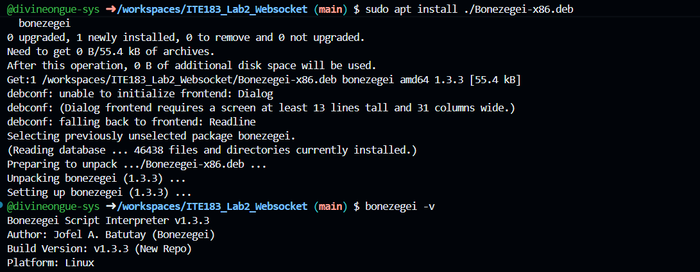
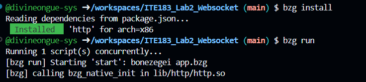
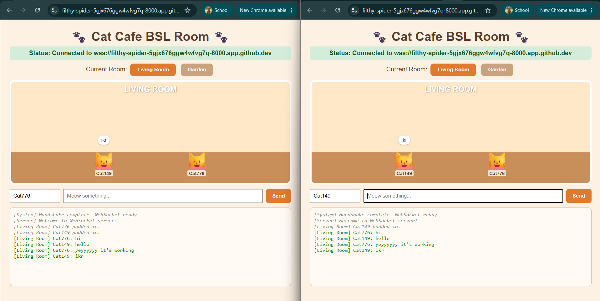
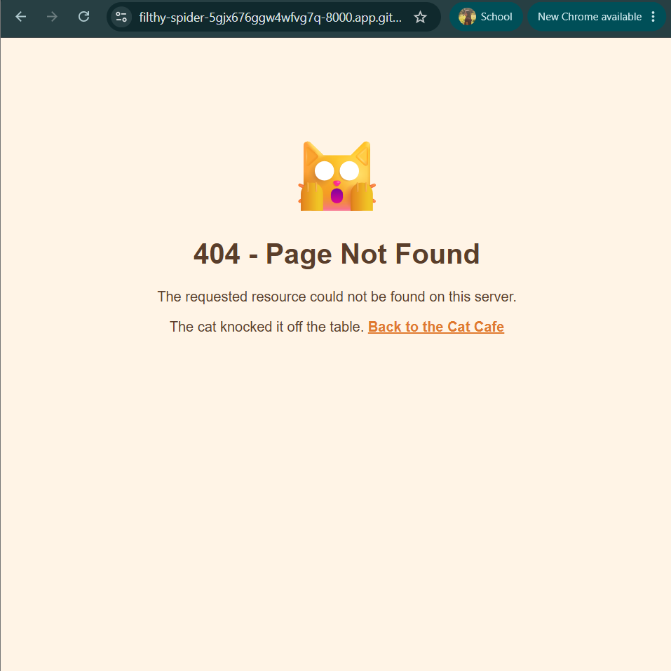

# ITE183 Lab 2: Event-Driven WebSocket Server (Cat Cafe BSL Room)

**By:** Divine Ongue

A real-time, multi-client chat room built with the Bonezegei Scripting Language (BSL v1.3.3) HTTP and WebSocket framework. Cats chat in two rooms, the Living Room and the Garden, with speech bubbles above each cat.

## Features
- Static file serving from `public/` and a custom cat-themed 404 page for undefined routes
- WebSocket connection lifecycle handling (connect, message, disconnect)
- Real-time broadcasting to every connected client with `server.sendAll()`
- Two chat rooms, filtered on the client side using a `room|name|message` format
- Custom cat names, per-room chat history, and speech bubbles

## Repository Structure

```
ITE183_Lab2_Websocket/
├── .gitattributes     # GitHub syntax highlighting for *.bzg files
├── LICENSE            # MIT License
├── README.md          # Project overview and documentation
├── package.json       # Project manifest and dependencies
├── app.bzg            # HTTP and WebSocket server
├── documentation/     # Screenshots for the lab report
└── public/
    ├── index.html     # Cat Cafe chat client
    └── 404.html       # Custom 404 page
```

## Prerequisites and Setup

Download and install Bonezegei v1.3.3 (Linux / GitHub Codespaces):

```
wget https://github.com/bonezegei/Bonezegei_Scripting_Language/raw/refs/heads/main/Release/Latest/Bonezegei-x86.deb
sudo apt install ./Bonezegei-x86.deb
```

Verify the version:

```
bonezegei -v
```

## Install Dependencies and Run the Server

```
bzg install
bzg run
```

Then open port 8000 in a browser (in Codespaces, use the forwarded address from the Ports tab). Open it in two or more windows to test the chat. Visit any other path, such as `/abc`, to see the custom 404 page.

> In Codespaces the page is served over HTTPS, so the client connects with a secure WebSocket (`wss://`). The client builds the address from the page URL, so this works automatically on both `localhost` and Codespaces.

## Lab Documentation

### Verification and Screenshot Deliverables

**Figure 1:** Terminal output showing Bonezegei version `1.3.3`.



**Figure 2:** `bzg install` and successful server startup with `bzg run`.



**Figure 3:** Multi-client real-time chat across two browser windows, showing messages broadcast to both clients with cat names and speech bubbles.



**Figure 4:** Custom `404.html` page rendered for an undefined path.



## How It Works
- `app.bzg` serves `public/index.html` at `/` and `public/404.html` for any other path.
- When a client connects, the server logs its ID and sends it a welcome message.
- Every message a client sends is broadcast to all connected clients as `User <id> says: <message>`.
- The client sends messages as `room|name|text` and only shows the ones that match the room you are in.
- Disconnections are logged on the server.

## Conclusion
Through this laboratory, full-duplex communication and asynchronous socket event handling were implemented using BSL v1.3.3. The project showed how WebSockets enable low-latency, real-time updates across multiple concurrent clients, together with static file serving and a custom 404 response.